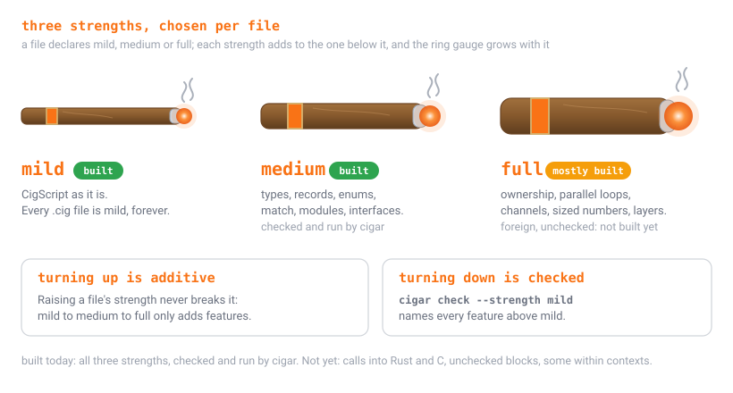
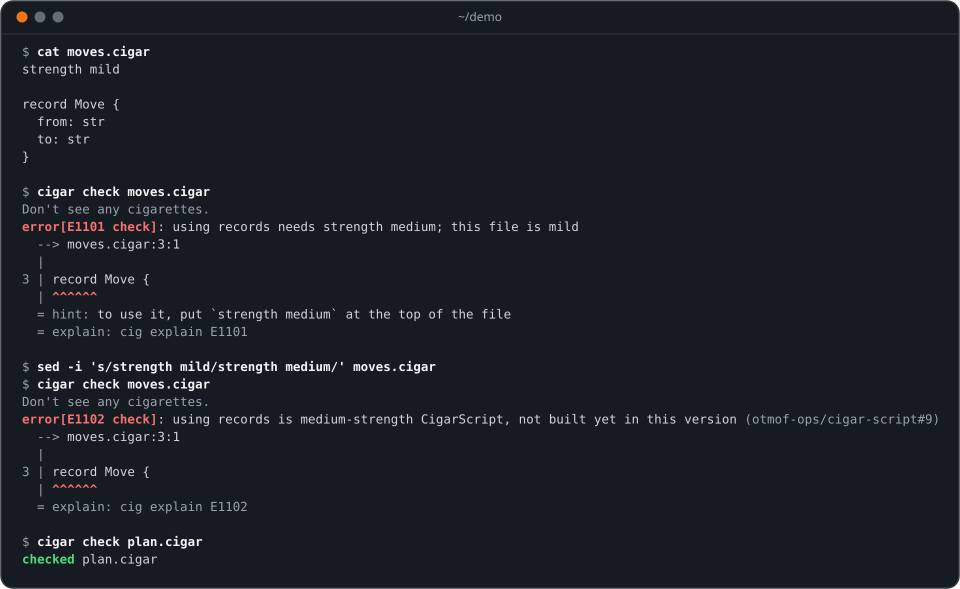

<p align="center">
  
</p>

<p align="center">
  <b>CigScript, grown deeper: three strengths, chosen per file.</b><br>
  <i>A language from the maker of <a href="https://github.com/otmof-ops/cig-script">CigScript</a>: the same words and the same rule, with types, ownership and more when you ask for them.</i>
</p>

<p align="center">
  <a href="https://github.com/otmof-ops/cig-script"></a>
  <a href="docs/LANGUAGE.md"></a>
  <a href="docs/roadmap.md"></a>
  <a href="docs/roadmap.md"></a>
  <a href="docs/roadmap.md"></a>
  <a href="LICENSE"></a>
</p>

CigScript is small on purpose: it automates, and it keeps one rule,
**nothing touches the world outside a burn**. Its own design says heavy
data work belongs in a program the script hops to. CigarScript is where
that program gets written, without leaving the family: the same words
(`stick`, `roll`, `pull`, `burn`, `cough`, `exhale`), the same rule, and
three **strengths** you choose per file. **Mild** is CigScript as it is.
**Medium** adds types, records, enums, `match`, modules and interfaces.
**Full** adds ownership, parallel loops, channels, sized numbers and
layered meanings (`within`, `layer`); calls into Rust and C are designed and
not built. Every `.cig` file is already valid CigarScript, forever.

**What works today is all three strengths, with four exceptions.**
`cigar check` reads a `.cigar` file's `strength` declaration, refuses every
feature above the strength (`E1101`), type-checks medium and full, checks
ownership at full, and then checks the result as `cig check` would.
`cigar run` runs it, as a cig program: every burn journaled, a plan with
`--dry-run`, rollback if the script fails. `foreign`, `unchecked` blocks,
user-declared `within` contexts, and custom journaling
adapters are not built; a file that uses the first three gets `E1102`, which
says so and names the issue. The syntax is **provisional** where the design
questions (#1 to #5) are open. CigarScript 0.1.0 is the first release and is
not on crates.io.

<p align="center"></p>

## Thirty seconds

```sh
$ printf 'strength mild\n\nrecord Move { from: Path, to: Path }\n' > moves.cigar
$ cigar check moves.cigar
Don't see any cigarettes.
error[E1101 check]: using records needs strength medium; this file is mild
  --> moves.cigar:3:1
  |
3 | record Move { from: Path, to: Path }
  | ^^^^^^
  = hint: to use it, put `strength medium` at the top of the file
  = explain: cig explain E1101
$ sed -i 's/mild/medium/' moves.cigar
$ cigar check moves.cigar
checked moves.cigar
$ printf 'exhale Move { from: "a", to: "b" }\n' >> moves.cigar
$ cigar run moves.cigar
Move { from: "a", to: "b" }
$ cigar check --strength mild moves.cigar
Don't see any cigarettes.
error[E1101 check]: using records needs strength medium; this file is mild
  --> moves.cigar:3:1
  |
3 | record Move { from: Path, to: Path }
  | ^^^^^^
  = hint: to use it, put `strength medium` at the top of the file
  = explain: cig explain E1101
$ cigar --json check --strength mild moves.cigar
{"code":"E1101","kind":"check","message":"using records needs strength medium; this file is mild","hint":"to use it, put `strength medium` at the top of the file","line":3,"col":1,"file":"moves.cigar"}
```

The first check is told which strength allows a record, and the fix; the
second passes; `cigar run` runs the file; turning it back down lists the
medium feature it uses with its place; `--json` gives one object per error, and
exit `2` when a check fails.

[Getting started](docs/getting-started.md) walks through it in ten
minutes, install included.

## See it run

A medium file with a record and typed functions passes the check, and
`cigar run --dry-run` prints the plan for its burn and changes nothing. One
wrong type, and the checker says where the value is and which signature it
broke.

<p align="center"></p>

## What works, and what does not yet

| | state |
|---|---|
| `cigar check` on a `.cig` file | **built.** Exactly what `cig check` does, of the cig version `cigar` is built on; a `.cig` file never gets a new error |
| `cigar check` on a `.cigar` file | **built.** The `strength` declaration, the feature gate, lowering, the type and ownership checks, and then CigScript's own check |
| `cigar run` | **built.** Checks, then runs as a cig program: plans, journals, rollback and run records are cig's; errors name your file and line |
| `E1101` to `E1104`, `E1201` to `E1219`, `E1301` to `E1304`, `E1311` to `E1313`, `E1401` to `E1405`, `E1501`, `E1502`, `E1510`, `E1520` | **built.** [The language](docs/LANGUAGE.md#errors) says when each comes |
| `--strength`, `--json`, `--plain`, `--no-color`, folders | **built.** Exit `0` checked, `2` a check failed, `3` could not check |
| mild: everything CigScript has | **built** |
| medium: types, records, enums, `match`, generics, interfaces, modules, `into`, `measure`, the typed standard library | **built**, provisional ([#8](https://github.com/otmof-ops/cigar-script/issues/8), [#9](https://github.com/otmof-ops/cigar-script/issues/9), [#10](https://github.com/otmof-ops/cigar-script/issues/10), [#11](https://github.com/otmof-ops/cigar-script/issues/11), [#13](https://github.com/otmof-ops/cigar-script/issues/13)) |
| full: `owned`, `borrow`, `move`, `parallel`, channels, `within retry`, `within parallel` and `within timeout`, sized numbers, `Bytes`, `layer` | **built**, provisional ([#12](https://github.com/otmof-ops/cigar-script/issues/12), [#13](https://github.com/otmof-ops/cigar-script/issues/13)). `parallel` runs in loop order on one thread today, so the journal is the sequential run's |
| full: `foreign` | **not built** ([#5](https://github.com/otmof-ops/cigar-script/issues/5)). Every use is `E1102` |
| full: `unchecked` blocks, user-declared `within` contexts | **not built** ([#12](https://github.com/otmof-ops/cigar-script/issues/12), [#13](https://github.com/otmof-ops/cigar-script/issues/13)). Every use is `E1102` |
| full: custom journaling adapters, scripts reading each other's results | **not built** ([#12](https://github.com/otmof-ops/cigar-script/issues/12), [#14](https://github.com/otmof-ops/cigar-script/issues/14)). No syntax yet |
| `cigar explain --layers file:line:col` | **built** ([#13](https://github.com/otmof-ops/cigar-script/issues/13)); `cig explain --layers` forwards to it once cig-script does |
| the experience warning | **built** ([#7](https://github.com/otmof-ops/cigar-script/issues/7)). Asked once per project when a file first goes to `strength full`; the answer is kept in the person's state folder |
| `cigar fmt` and `cigar-lsp` | **built** ([#16](https://github.com/otmof-ops/cigar-script/issues/16)). The formatter is idempotent and runs over the lexer `cigar check` uses; `cigar-lsp` speaks LSP over stdio from the same crates |
| the VS Code extension and the tree-sitter grammar | **built** ([#16](https://github.com/otmof-ops/cigar-script/issues/16)), in `editors/`; installed from source or a VSIX today, not published to a marketplace yet |
| compiling a `.cigar` file | **not built.** CigCompile builds CigScript today; CigarScript comes through it later. `cigar run` runs it |
| carton | **not built** ([#15](https://github.com/otmof-ops/cigar-script/issues/15)) |
| `cig explain E1101` | no page yet: the codes are registered in cig when CigarScript ships; the message says all of it |

The design questions (#1 to #5) are open, and the answers in
[the language](docs/LANGUAGE.md) are provisional until they are decided.
Each item above is on the [roadmap](docs/roadmap.md).

## Guides

| guide | read it when you want to |
|---|---|
| [Getting started](docs/getting-started.md) | install `cigar`, check your first file, and put the check in CI |
| [Mild](docs/guides/mild.md) | you know CigScript: you already know it |
| [Medium](docs/guides/medium.md) | write types, records, enums, `match`, modules and interfaces, and run them |
| [Full](docs/guides/full.md) | use ownership, parallel loops, channels, sized numbers and layers, and see what is not built |
| [Commands](docs/commands.md) | look up `cigar check`, `cigar run`, `cigar fmt`, `cigar explain` and `cigar-lsp`, every flag, the exit codes and the JSON shape |
| [Editors](docs/editors.md) | set up `cigar-lsp` in your editor, build the VS Code extension and the tree-sitter grammar from source |
| [The language](docs/LANGUAGE.md) | read the strengths, the feature table, the grammar and the open decisions |
| [Lexicon](docs/LEXICON.md) | find a word (`strength`, `carton`, `record`, `within`, `pub`) and the manual's name for it |
| [Roadmap](docs/roadmap.md) | see what is built, what is next, and the issue behind each |
| [The design](docs/CIGARSCRIPT-AND-CIGCOMPILE.md) | read where CigarScript and CigCompile are going, and why |

Every `cigar` sample in these pages is checked by the docs test: a block that
should pass does, and one marked to fail (`# expect: E1101`, or any other
code) gives that error first. Multi-file samples write each module as its own
block, with its path after the language.

## Install

Once carton 1.0.0 is published, `cigar` is installed by
[`ciginstaller`](https://github.com/otmof-ops/cig-installer), the one way to
install the CigScript family:

```sh
ciginstaller install carton
```

The installer's manifest decides which carton, pack or stick carries `cigar`;
until carton 1.0.0 lists one, nothing above installs it. No `ciginstaller`
yet? Get it from <https://github.com/otmof-ops/cig-installer#install>.
Until then, [build from source](#build-from-source), or take the archive
for your machine from the v0.1.0 release directly:

```sh
# Pick your machine's archive from the release, e.g. linux-x86_64
ver=0.1.0
asset=cigar-v$ver-linux-x86_64.tar.gz
gh release download v$ver -R otmof-ops/cigar-script -p "$asset" -p "$asset.sha256" -p SHA256SUMS
sha256sum -c "$asset.sha256"
gh attestation verify "$asset" -R otmof-ops/cigar-script
tar -xzf "$asset"
./bin/cigar --version
```

Each release archive holds `bin/cigar` and `bin/cigar-lsp` (`.exe` on
Windows). The release also carries `SHA256SUMS`, one `.sha256` per
archive, and build attestations verifiable with `gh attestation verify`.

`ciginstaller uninstall cigar` removes it and clears its run cache
(`~/.cache/cigar/run`, or `%LOCALAPPDATA%\cigar\run` on Windows), which holds
only programs `cigar run` can build again.

## Build from source

`cigar` is not on crates.io. With Rust 1.82 or newer, from a checkout:

```sh
git clone https://github.com/otmof-ops/cigar-script
cd cigar-script
cargo build --release
target/release/cigar --version
```

`cargo test` runs the checker's tests and the docs test. `cigar run` is part of the same binary.

## Measuring CigarScript

`bench/bench.toml` is the manifest for `cig bench`, the family's benchmark tool
([docs](https://github.com/otmof-ops/cig-script/blob/main/docs/BENCH.md)). From a
checkout with `cargo build --release` done, `cig`, `cigar` and a CigScript
checkout beside this one (`../CigScript`):

```sh
cig bench bench/bench.toml                         # every case: the nightly
cig bench bench/bench.toml --group check-1k        # one group
cig bench bench/bench.toml --group superset        # cig run against mild cigar run
cig bench bench/bench.toml --timings               # where `cigar check` spends it
cig bench bench/bench.toml --against origin/main   # A/B against another ref
```

| group | what it measures |
|---|---|
| `check-100`, `check-1k`, `check-10k`, `check-100k` | `cigar check` of the same program at mild, medium and full, at 100, 1,000, 10,000 and 100,000 lines |
| `inference` | generics-heavy code at medium and full, 1,000 and 10,000 lines |
| `exhaustiveness` | `match` over five-variant enums, every one covered, 1,000 and 10,000 lines |
| `superset` | cig's shared compute set (21 programs) as `cig run` and as mild `cigar run`; each must print cig's own expected output, or the case is `WRONG` and gets no time |
| `check-corpus` | the CigScript examples through `cigar check` and `cig check` |
| `memory-*` | today's runtime on the three programs of the [memory decision](docs/decisions/0002-memory.md) |

The programs come from `bench/fixtures/generate.py`, which uses no clock and no
random numbers: its output is the same on every machine, and
`bench/fixtures/SHA256SUMS` holds the sha256 of every file
(`python3 bench/fixtures/generate.py --check <dir>` compares). They are written
into `bench/generated/`, which is not committed.

**Timings are reported, never gated.** The superset group puts the two columns
side by side so the cost of running CigScript as CigarScript can be read; it
does not fail a build. `cigar run` builds its program once per home, so on the
isolated home every sample gets, that build is in the `cigar` column.

**Phases.** When `CIG_TIMINGS_FD` names an open descriptor, `cigar` writes the
time of each phase to it as one JSON line (`{"v":1,"product":"cigar","phase":"typeck","ms":0.412}`),
and `cig bench --timings` shows them: `lex` (the strength declaration), `gate`
(the feature gate), `lower`, `typeck`, `own` (strength full only), `cig`
(CigScript's own check of what will run) and `run` (the program, under `cigar
run`). Unset, `cigar` reads no clock and writes nothing.

**Not measured yet,** each waiting on the issue that makes it possible: types
for speed ([cig-compile#34](https://github.com/otmof-ops/cig-compile/issues/34)),
automatic memory against ownership at full
([#12](https://github.com/otmof-ops/cigar-script/issues/12)), calling Rust and C
([#5](https://github.com/otmof-ops/cigar-script/issues/5)) and reading other
scripts' results ([#14](https://github.com/otmof-ops/cigar-script/issues/14)).

The suite runs nightly (`.github/workflows/bench-nightly.yml`) and its results
go to the `bench-history` branch, where `cig bench history` reads them.

## Part of CigScript

CigarScript is built on CigScript, the language at
[otmof-ops/cig-script](https://github.com/otmof-ops/cig-script): `cigar`
reads, lowers and checks a file through the `cigscript` library of the version it
pins, so what mild accepts is what `cig check` accepts, and `cigar run` runs the
lowered script with cig's own runtime: its plans, journals and rollback. The lexicon, the
burn rule and the kernel are there. [CigCompile](https://github.com/otmof-ops/cig-compile)
compiles CigScript today, and will compile CigarScript later. The design is
[docs/CIGARSCRIPT-AND-CIGCOMPILE.md](docs/CIGARSCRIPT-AND-CIGCOMPILE.md), and
the work is in the [issues](https://github.com/otmof-ops/cigar-script/issues).

## Licensing

- **Code** (`src/`, `tests/`, `bench/`): **source-available, not open source.** Under the
  [Functional Source License, version 1.1, with an Apache-2.0 future license
  (FSL-1.1-ALv2)](LICENSE). The Open Source Initiative does not count it as an
  open source license, and this project does not call it one.
  - *What you may do.* Use it, including inside a company for its own work;
    read it, study it, change it and share it with the license attached; and
    help others use it. The source is here for all of that.
  - *What you may not do.* Make it available to others in a commercial product
    or service that substitutes for it or does the same job. Selling it, or
    selling access to it, is the clear case.
  - *It becomes Apache-2.0.* Each version converts to
    [Apache-2.0](LICENSES/Apache-2.0.txt) two years after it is made
    available.
  - *Earlier releases.* Commits before the change were published under Apache-2.0 and stay under it; no release was made in that period. [LICENSING.md](LICENSING.md)
    lists which versions carry which license.
- **Documentation** (`docs/`, this README and the other guides at the root):
  [CC BY 4.0](LICENSES/CC-BY-4.0.txt). Reuse and adapt with credit.
- **The name.** CigarScript is a trademark of Jay Taylor, as CigScript is.
  Another implementation or a fork needs a name of its own;
  [TRADEMARKS.md](TRADEMARKS.md) says what is free to do and what to ask about
  first.

[REUSE.toml](REUSE.toml) maps every path to its license. Contributions come in
under the contributor agreement; see [CONTRIBUTING.md](CONTRIBUTING.md).
Security reports: [SECURITY.md](SECURITY.md).
